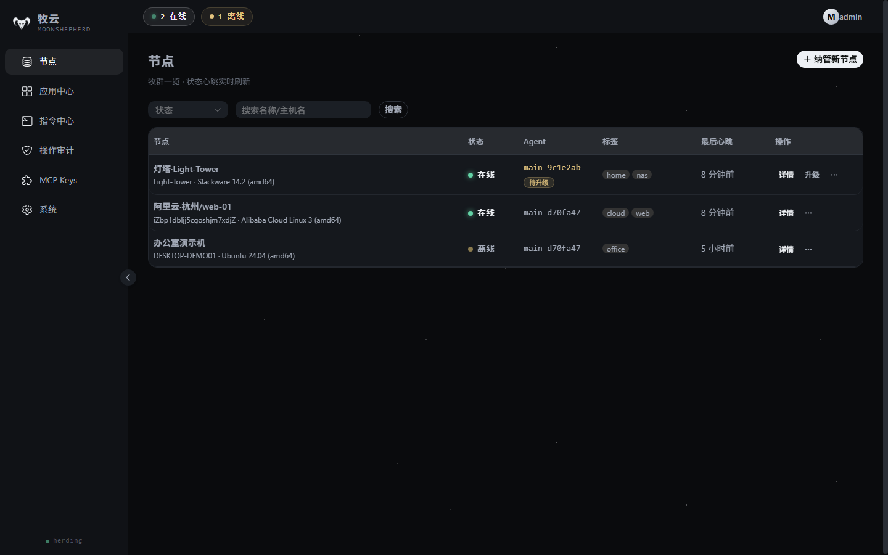
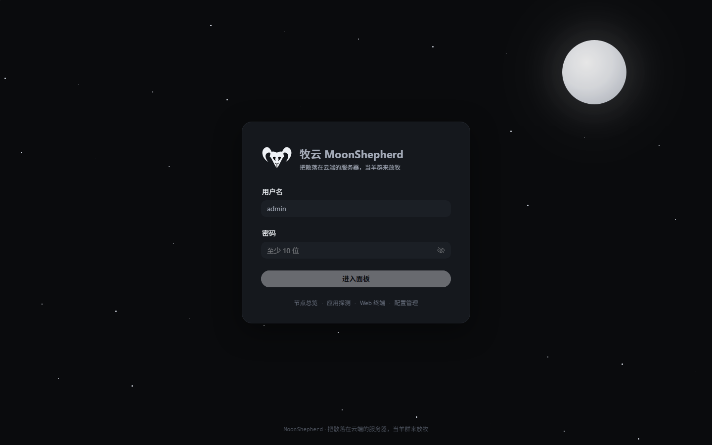

<div align="center">


# 牧云 MoonShepherd

**把散落在云端的服务器，当羊群来放牧。**

自托管的跨服务器统一管理面板：一个 Web 界面遥控并感知一群性格迥异的 Linux 节点——温顺的标准云主机，或者 Unraid 这种只有 BusyBox、没有 systemd 的刺头。

[](https://github.com/Aealen/moonshepherd/actions/workflows/ci.yml)


[功能总览](#-功能总览) · [快速开始](#-快速开始) · [AI 客户端接入](#-让-ai-替你放牧mcp) · [设计文档](#-设计文档)

</div>

---

| 主面板 · 节点总览 | 登录页 |
|---|---|
|  |  |

## 🐑 功能总览

### 节点牧群
- **主动外连纳管**——Agent 以 Docker 容器 / 静态二进制 / systemd 等多种形态部署，主动 WSS 外连面板，**无需开放节点入站端口**；HMAC 挑战式认证
- **心跳与指标**——CPU / 内存 / 磁盘 / 网络实时心跳，在线/离线状态即时刷新
- **一键接入**——面板发放注册 Token 后，目标节点上一条 `install.sh` 完成安装注册；Agent 自带**自更新**：旁路写入不动旧二进制、失败自动回滚、systemd / 裸跑形态自适应，防失联三重保障

### 应用感知与容器
- **探测器插件**——自动发现节点上的应用：Docker 容器、Nginx、Caddy、systemd 服务，插件化渐进扩展
- **应用详情**——镜像 / 端口映射 / 目录挂载 / 网络与环境变量；Docker 应用自动识别**启动方式（Docker Compose 还是 Docker Run）**并展示 ENTRYPOINT / CMD / 重启策略
- **容器操作**——启动 / 停止 / 重启 / 拉取镜像（白名单，无删除），**容器日志实时流**回浏览器
- **配置发现与纳管**——Nginx / Caddy 配置文件自动探测，纳管后在线编辑、版本化下发，自带校验与失败自动回滚

### 运维与安全
- **Web 终端**——浏览器直达节点 PTY，窗口尺寸自适应，全程审计
- **指令中心**——跨节点远程命令执行，输出可查，全程审计
- **文件管理器**——目录树浏览、分片上传下载、在线编辑、重命名 / 移动 / 删除，全部变更留痕
- **操作审计**——只读、不可删除的全量操作审计
- **公网级安全**——TLS 强制、分层威胁模型、最小权限 MCP 授权（见 [安全设计](docs/05-安全设计.md)）

### 🤖 让 AI 替你放牧（MCP）
内置 **MCP Server（Streamable HTTP）**，Claude Desktop 等 AI 客户端可安全操控牧云：

- **12 个工具**：节点列表 / 指标查询、应用清单、容器日志、容器操作、远程命令、文件读写……
- **两级授权**：能力（scope，决定"能做什么"）× 范围（节点 → 应用，决定"对哪些对象做"），随时编辑即时生效
- **Key 管理**——面板创建 / 启停 / 吊销，高危能力（命令执行）创建时二次确认
- **全程审计**——授权范围外的请求被拒绝并记录

## 🚀 快速开始

### 面板（任意 Docker 机 / NAS）

```bash
docker run -d --name herd --restart unless-stopped \
  -p 8080:8080 -v ./data:/app/data \
  ghcr.io/aealen/moonshepherd:latest
```

首次启动日志打印随机 admin 密码（或 `-e HERD_ADMIN_PASSWORD=...` 指定）。CI 自动构建 amd64 / arm64 双镜像推 GHCR，也支持 `packaging/docker-compose.yml` 本地编排。

### Agent 接入节点

面板「节点注册」发放 Token 后，在目标节点上执行（脚本由面板动态渲染，自动适配面板地址与系统架构）：

```bash
curl -fsSL http://<面板地址>/install.sh | bash -s -- --token rt_xxx
```

- **标准 Linux**：安装为 systemd 服务
- **Unraid 等 BusyBox 环境**：Docker 容器形态（挂载 `docker.sock` 获得完整容器能力）
- **公网面板**：节点同样只出不进；面板侧请前置 TLS（详见 [安全设计](docs/05-安全设计.md)）

### Agent 自更新

面板「节点」页可一键下发升级（按节点架构自动匹配二进制），Agent 端校验 sha256 → 旁路写入 → 平滑换身 → 失败自动回滚，升级期间不失联。

## 🤖 AI 客户端接入（MCP）

```text
URL:     https://<面板域名>/mcp
Header:  Authorization: Bearer mcp_xxx…（面板「MCP Keys」创建，仅显示一次）
```

之后对 AI 说"列一下节点""看下 Gitea 容器日志"即可——授权范围外的请求会被拒绝并记录审计。接入示例（Claude Desktop）：

```json
{ "mcpServers": { "moonshepherd": {
    "type": "http", "url": "https://面板地址/mcp",
    "headers": { "Authorization": "Bearer mcp_xxx…" } } } }
```

## 🏗️ 架构

```
                ┌─────────────────────────┐
                │   牧云面板（单二进制或容器）   │
                │   SQLite 存储 · MCP 内嵌    │
                └───────────△─────────────┘
                            │ Agent 主动 WSS 外连（免入站端口）
        ┌───────────────────┴──────────────────┐
        │                                      │
  节点A Unraid                            节点B 阿里云ECS
  Agent=Docker容器(挂docker.sock)          Agent=systemd(install.sh 一键)
  (备选:裸二进制+UserScripts)              (备选:裸二进制)
```

## 📚 设计文档

| 文档 | 内容 |
|---|---|
| [01-产品总体设计](docs/01-产品总体设计.md) | 架构、Agent/面板设计、通信协议、数据模型、配置管理流程、安全设计 |
| [02-技术选型与工程结构](docs/02-技术选型与工程结构.md) | 技术栈定稿与理由、仓库结构、构建与分发 |
| [03-迭代路线图](docs/03-迭代路线图.md) | MVP 边界、P0/P1/P2 迭代计划、里程碑、风险与待定项 |
| [04-通信协议规范](docs/04-通信协议规范.md) | 节点身份认证（HMAC 挑战）、WSS 消息字段级定义、指令幂等与重连语义 |
| [05-安全设计](docs/05-安全设计.md) | 公网产品级威胁模型、分层防御、公网部署 checklist |
| [06-面板API与页面设计](docs/06-面板API与页面设计.md) | REST API 端点、浏览器实时事件通道、前端页面结构与交互规范 |
| [07-MCP服务设计](docs/07-MCP服务设计.md) | MCP Server 架构、工具清单、两级授权模型 |
| [07a-MCP实现规范](docs/07a-MCP实现规范.md) | MCP 工具实现细节与校验规则 |

## 🛠️ 本地开发

```bash
make dev            # 前端 vite 热更(:5173) + 面板(:8080)，数据在 ./data
make test           # go test ./...
make backend        # dist/moon + dist/herd（本机平台）
make cross          # Linux amd64/arm64 交叉编译（Agent 另有 armv7）
```

前端技术栈：Vue 3 + Naive UI + Pinia + Vite；面板 Go 内嵌前端产物（go:embed）。

## 📌 状态

**v0.1.0 已发布**（见 Releases / Tags）。协议、终端、容器、文件、MCP、Agent 自更新等核心能力全部落地，全链路审计贯穿；已在内网 NAS（Unraid）与公网云主机上稳定运行。

---

语言：中文 · 产品代号：**MoonShepherd** · 技术栈：Go + Vue 3
