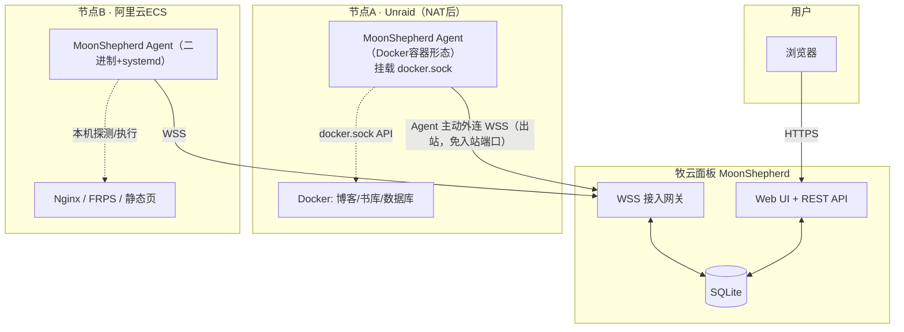
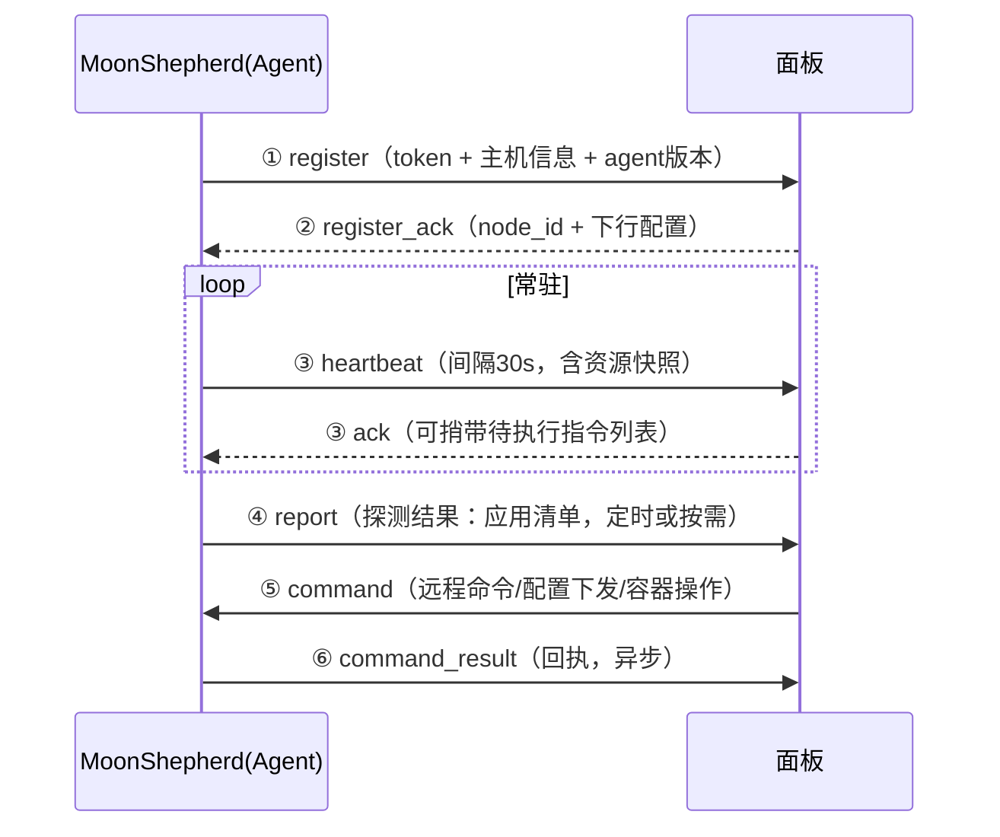
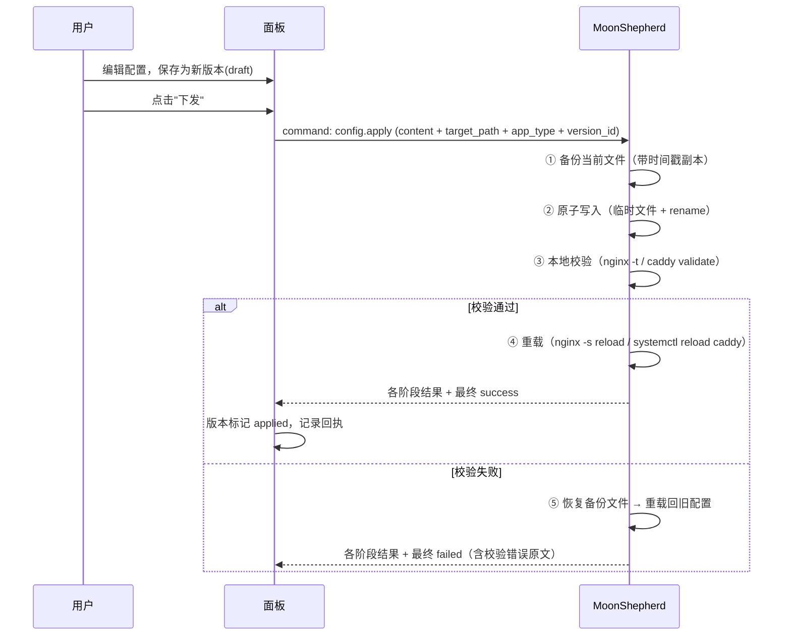

# 牧云 MoonShepherd · 产品总体设计

> 版本：v0.1（设计稿） · 日期：2026-10-25
>
> 姊妹文档：[02-技术选型与工程结构](02-技术选型与工程结构.md) · [03-迭代路线图](03-迭代路线图.md) · [04-通信协议规范](04-通信协议规范.md) · [05-安全设计](05-安全设计.md)

## 1. 产品概述

### 1.1 背景与痛点

用户的节点群由两类异构机器组成：

| 节点 | 系统 | 特点 | 运行的应用 |
|---|---|---|---|
| 节点 A（家庭 NAS） | Unraid | Slackware + BusyBox 用户空间，**无 systemd**，无包管理器，社区哲学禁止修改基础系统；位于家庭 **NAT 之后**，无公网入站能力 | Docker：博客、书库、数据库等 |
| 节点 B（云主机） | 阿里云 ECS | 标准 Linux，资源有限（网络代理跳板机） | FRPS、Nginx/Caddy、静态页面 |

痛点：

1. Unraid 受限的命令环境导致大量运维脚本不可用；
2. 缺少统一后台对多节点做应用安装、应用配置管理；
3. 缺少对节点"已安装了什么应用"的统一感知（现有工具都是搭好的，不是从面板装出来的）。

### 1.2 产品定位

**一个轻量自托管的多节点服务器管理面板**：中心 Web 面板 **MoonShepherd（月下牧人，即中文品牌"牧云"）** + 各节点受控端 Agent **`herd`（牧群成员）**——节点即羊群（Herd），面板即牧人（Shepherd），Moon 照亮云端牧场；牧（mù）与 Moon 谐音，中英文名共享同一幅画面。

核心能力（按用户原话归纳）：

1. **应用安装与配置管理**：常用应用（Caddy、Nginx、Docker…）逐个支持，不求一步到位；
2. **应用检测上报**：Agent 检测节点已安装的应用并上报面板，这是第一等公民功能；
3. **统一 Web 面板**：一个入口管所有节点。

### 1.3 非目标（明确不做）

- 不做 Kubernetes 编排（那是 Rancher 的战场）；
- 不做完整的监控告警平台（Prometheus 生态的战场），只做节点级基础监控；
- 不追求管理上百节点（目标是个人/小团队的个位数到几十台）；
- 不做 Windows 节点支持（当前场景无需求）。

## 2. 总体架构

### 2.1 架构图



### 2.2 关键架构决策（ADR 摘要）

| # | 决策 | 理由 |
|---|---|---|
| ADR-1 | **Agent 主动外连**（WSS 长连接），面板永不直连 Agent | 节点 A 在 NAT 后无入站能力；同时天然减小受控端攻击面 |
| ADR-2 | **指令复用既有 WSS 连接下发** | 不需要面板能反向到达 Agent，与 ADR-1 配套 |
| ADR-3 | **一份 Go 代码核心，多形态只是分发包装** | Docker 容器、systemd 二进制、裸二进制共用同一二进制产物，不维护多套客户端 |
| ADR-4 | **Agent 静态编译 `CGO_ENABLED=0`** | 零依赖运行于 BusyBox 环境（Unraid）；交叉编译 amd64/arm64/armv7 |
| ADR-5 | **面板单二进制 + SQLite（前端 embed）** | 部署位置自由：今天放云机、明天挪 NAS，搬迁 = 拷一个文件 + 一个库文件；同时提供 Docker 镜像形态 |
| ADR-6 | **探测器插件机制** | "对每种应用的渐进式支持"落地为一个个独立的探测器，新增应用支持不动核心 |
| ADR-7 | **配置下发必须"备份→写入→本地校验→重载→失败回滚"** | 配置自动化对在线服务的破坏风险是本产品最大风险点，安全机制先于功能 |

## 3. Agent 设计（MoonShepherd）

### 3.1 多形态分发矩阵

| 形态 | 目标环境 | 安装方式 | 自启机制 |
|---|---|---|---|
| F1 静态二进制 + systemd | 标准 Linux（节点 B） | `curl -s URL/install.sh \| bash -s -- --token xxx` | install.sh 自动生成 systemd unit |
| F2 Docker 容器 | Unraid（节点 A）及一切 Docker 机 | 一条 `docker run` 或 compose 片段 | Docker restart 策略 |
| F3 裸二进制 + 兼容自启 | Unraid 等无 systemd 环境 | 下载二进制 + 自启脚本模板 | install.sh 探测：无 systemd 时退回 rc.local / User Scripts 模板 |
| F4 Unraid 原生插件 `.plg` | Unraid 社区体验 | Community Applications | Unraid 插件体系（**远期，P2**） |

实现要点：

- **install.sh 是统一入口**：自动探测 `systemd → 装 unit；无 systemd → 输出 User Scripts/rc.local 模板`。F1 与 F3 被同一脚本覆盖。
- **F2 与 F1/F3 共用同一个二进制**：镜像 `FROM scratch` + `COPY herd`，按需挂载：
  - `/var/run/docker.sock`（Docker 探测与容器操作）
  - `/etc/nginx`、`/etc/caddy` 等（配置管理，见 §6）
  - `/boot`（Unraid 插件探测，只读，可选）
- **分发通道③已实现（面板自带下发）**：面板镜像内嵌三架构 herd 二进制（`/app/dist`），`GET /install.sh` 动态渲染安装脚本、`GET /dist/herd-linux-{arch}` 下发二进制——私有部署零外部依赖（通道①GHCR 需包公开、通道②Release 需仓库公开，开源后再启用）。
- **注册模型与形态解耦**：所有形态只认两个参数——面板地址 `HERD_SERVER`（wss://…）+ 注册 Token。面板将来挪位置，Agent 改一个环境变量即可。

### 3.2 Agent 生命周期



状态定义（面板视角的节点状态）：`online`（心跳在 3 个周期内）/ `offline`（心跳超时）/ `pending`（已发 Token 未注册）。

### 3.3 探测器（Probe）——"应用检测上报"的落地点

每种应用一个探测器，统一接口（Go）：

```go
type Probe interface {
    Name() string                       // "docker" / "nginx" / "caddy" / ...
    Detect(ctx context.Context) ([]App, error)  // 返回发现的应用实例列表
}
```

`App` 结构（上报载荷）：应用类型、名称、版本、运行状态、原始详情（JSON，原样落库供面板展示）。

探测器首期清单：

| 探测器 | 探测手段（多级降级） | 说明 |
|---|---|---|
| docker | 优先 docker.sock HTTP API；降级 `docker ps -a --format json` | 容器列表 + 状态 + 镜像 + compose 项目标签（`com.docker.compose.project`） |
| nginx | `nginx -v` / 进程探测 / 配置目录扫描（/etc/nginx） | 版本 + 运行状态 + 配置文件清单 |
| caddy | `caddy version` / 进程探测 / /etc/caddy 扫描 | 同上 |
| systemd | `systemctl list-units --type=service`（仅标准 Linux） | 节点 B 的 FRPS 等进程型服务 |
| unraid | 扫描 /boot/config/plugins（仅 Unraid） | 已装 Unraid 插件清单 |

探测策略：注册时全量探测一次；此后按间隔（默认 5 分钟）定时探测 + 面板可随时触发即时探测。多级降级保证在 BusyBox/受限环境下尽量出结果，探不出就明确上报 `unknown`，不臆造。

### 3.4 执行器（Executor）

Agent 内负责执行面板下发的指令，指令类型首期五种：

| 指令类型 | 说明 | 安全约束 |
|---|---|---|
| `exec` | 执行 shell 命令，回传 stdout/stderr/exit code | 超时上限（默认 120s）、输出截断（默认 1MB）、全程落审计 |
| `probe` | 触发一次或全部探测器即时上报 | 无风险 |
| `config.apply` | 配置下发全流程（见 §6） | 内置备份/校验/回滚 |
| `docker.op` | 容器启停/重启/查日志（P1） | 白名单操作，不支持任意 docker 命令 |
| `agent.update` | Agent 自更新（P1） | 二进制校验和 + 版本号比对 |

长任务异步化：所有指令带唯一 `command_id`，Agent 立即回执 `accepted`，执行完毕再回传 `command_result`。面板端指令表记录状态机 `pending → sent → running → success/failed`。

### 3.5 Agent 自更新（多形态下唯一有差异的运维点）

- **二进制形态（F1/F3）**：面板下发 `agent.update` → Agent 下载新版本（校验 sha256）→ 写临时文件 → 原子替换自身 → 拉起新进程退出旧进程。
- **Docker 形态（F2）**：遵循容器不可变原则，面板下发"升级"指令触发宿主侧 `docker pull` + 重建（P1 实现重建编排；MVP 期提示用户手动更新容器）。

## 4. 面板设计（MoonShepherd）

### 4.1 功能模块

```mermaid
flowchart LR
    subgraph 面板
        A[节点管理] --> A1[注册Token发放/节点列表/状态]
        B[应用中心] --> B1[各节点应用清单/版本/状态]
        C[指令中心] --> C1[远程执行/历史/审计]
        D[配置管理] --> D1[版本化编辑/校验下发/回滚]
        E[监控] --> E1[资源快照/历史曲线(P1)]
        F[系统] --> F1[用户/认证/审计日志/设置]
    end
```

- **节点管理**：发放一次性注册 Token（避免裸奔注册）；节点详情含主机信息、Agent 版本、标签（自定义分组）。
- **应用中心**：跨节点视角浏览"谁装了什么"；单节点视角看该机应用清单（来自探测器上报的原始 JSON 渲染）。
- **指令中心**：发起远程命令（目标节点 + 命令 + 超时），查看历史与回执；所有指令不可删除，只读审计。
- **配置管理**：见 §6。
- **认证**：MVP 单管理员（用户名密码 + bcrypt）；P1 加 TOTP 二步验证。

### 4.2 面板部署形态

- **单二进制**：`moon`，前端静态资源 embed 进二进制，`./moon server --data ./data` 即跑；数据 = 一个 SQLite 文件。
- **Docker 镜像**：`moon` 官方镜像 + compose 样例（放 NAS / 任何 Docker 机）。
- **面板机纳管（P1 落实引导）**：面板所在宿主机自身也是受管节点时，直接以标准独立 Agent 进程接入，与远程节点完全同构（不采用进程内嵌方案，决策见 [03](03-迭代路线图.md) §6.2）。

## 5. 通信协议（WSS 消息）

> 本章为概念概览。字段级消息定义、节点身份认证握手、指令幂等与重连语义，完整规范见 **[04-通信协议规范](04-通信协议规范.md)**。

### 5.1 消息信封

单条 WSS 文本帧，JSON 信封：

```json
{
  "id": "9f1c...（UUID，消息唯一标识）",
  "type": "heartbeat",
  "ts": 1761139200,
  "payload": { }
}
```

### 5.2 消息类型

| type | 方向 | payload 要点 |
|---|---|---|
| `register` | A→P | token、hostname、os（name/version/arch）、agent_version、能力集（可用探测器列表） |
| `register_ack` | P→A | node_id、心跳间隔、探测间隔等下行配置 |
| `heartbeat` | A→P | CPU/内存/磁盘/网络快照（单点值） |
| `report` | A→P | 应用清单 `[]App` + 探测器名 + 时间戳 |
| `command` | P→A | command_id、指令类型（§3.4 五种）、payload、超时 |
| `command_result` | A→P | command_id、状态、stdout/stderr、exit code、结构化结果（如配置下发各阶段） |
| `log_tail`（P1） | P→A / A→P | 容器/服务日志流（分片推送） |
| `error` | 双向 | 错误码 + 描述 |

协议版本字段放在 register 中（`proto_version`），面板兼容旧版 Agent 至少一个大版本。

## 6. 配置管理流程（本产品最危险的功能，流程即安全设计）

### 6.1 流程



### 6.2 设计规则

1. **版本化**：每次编辑产生不可变版本记录（content + checksum + 作者 + 时间），当前生效版本有标记；
2. **回滚即下发**："回滚到历史版本" = 把旧版本内容再走一遍完整下发流程（复用同一套校验/回滚保护），不做文件级直接覆盖；
3. **原子写入**：任何文件写入都是"写临时文件 + rename"，中途崩溃不留半截文件；
4. **校验命令按应用注册**：每种受管应用声明自己的 `validate` 与 `reload` 命令（nginx、caddy 首期内置），未知应用不允许跳过校验下发；
5. **备份保留策略**：Agent 侧按应用保留最近 N 份（默认 10），面板侧永久存版本历史；
6. **权限前提**：Agent 需要对目标配置路径的写权限与重载权限（F2 容器形态通过挂载对应目录实现）。

## 6.5 配置发现（已实现）

探测器为 nginx/caddy 产出可纳管的配置候选（`config_candidates`，面板「配置」页一键纳管，路径可手改兜底）：

| 发现链 | 覆盖 | 说明 |
|---|---|---|
| `nginx -T` 解析 | 宿主机 nginx 全量 | 最准：实际加载清单，include 全展开（含非标准路径）；配置有错则退目录扫描 |
| caddy 主配置 + import 链 | 宿主机 caddy | 常见位置 Caddyfile + `caddy adapt` 可解析性验证，import 文件从 adapt 输出抽取 |
| Docker 容器挂载推断 | 容器化 nginx/caddy | 镜像名含 nginx/caddy 的容器，挂载目标命中 `/etc/nginx*`/`/etc/caddy*`/`/srv*` → 挂载源为候选；匿名卷/命名卷跳过 |

候选仅作展示与 prefill，纳管动作仍是用户显式确认（创建配置目标）。


## 7. 数据模型（SQLite 核心表）

| 表 | 关键字段 | 说明 |
|---|---|---|
| `nodes` | id, name, agent_version, os_name, os_arch, status, last_seen, tags, capabilities(json), credential_enc | 节点注册信息与在线状态；credential_enc = AES-256-GCM 加密存储的 node_secret（见 [05](05-安全设计.md) §3.4） |
| `registration_tokens` | id, token_hash, status(active/used/revoked), expires_at, created_at | 一次性注册 Token（只存哈希，见 [04](04-通信协议规范.md) §2.2） |
| `app_inventory` | id, node_id, probe_name, app_name, app_type, version, status, detail(json), detected_at | 应用清单（每次全量探测覆盖式更新该节点该探测器行） |
| `commands` | id, node_id, type, payload(json), status, stdout, stderr, exit_code, created_by, created_at, finished_at | 指令审计（不可删除） |
| `config_versions` | id, node_id, app_type, target_path, content, checksum, status(draft/applied/rolled_back), created_by, created_at, apply_result(json) | 配置版本历史 |
| `metrics` | id, node_id, ts, cpu, mem_used, mem_total, disk_used, disk_total, net_rx, net_tx | 资源快照时序（按保留策略清理，如 7 天） |
| `users` | id, username, password_hash, totp_secret?, role | 面板账户（MVP 单管理员） |
| `audit_logs` | id, user_id, action, target, detail(json), ip, created_at | 面板侧操作审计 |

## 8. 安全设计（摘要）

> 面板将部署于公网、产品将供用户管理其公网机器——**按公网产品级标准设计，默认配置即安全**。完整威胁模型、分层防御与部署 checklist 见 **[05-安全设计](05-安全设计.md)**；节点身份认证机制见 [04](04-通信协议规范.md) §2。

| 层面 | 核心措施（详见 05） |
|---|---|
| 传输 | 全链路 WSS/HTTPS（TLS 强制）；证书：前置反代（主推）/ 手动证书（P0 兜底）/ ACME（P2 加分项） |
| 节点接入 | 一次性注册 Token → node_secret（HMAC 挑战认证，防重放） |
| 指令通道 | 只走已认证连接，面板不主动连 Agent（受控端零入站监听）；危险操作二次确认 |
| 面板认证 | bcrypt + 服务端会话（HttpOnly/Secure/SameSite=Strict）+ **登录防爆破限流（P0）** |
| 审计 | `commands` / `audit_logs` 不可删除 |
| 凭据存储 | 注册 Token 只存哈希；node_secret AES-256-GCM 加密落库（master.key 0600） |
| 更新完整性 | 强制 https + sha256 校验 + 禁降级 |

## 9. 本文档未覆盖 / 见其他文档

- 技术栈选型细节与理由、仓库结构、构建发布流水线 → [02-技术选型与工程结构](02-技术选型与工程结构.md)
- MVP 边界、迭代计划、风险跟踪 → [03-迭代路线图](03-迭代路线图.md)
- 通信协议字段级定义、节点身份认证、指令幂等与重连语义 → [04-通信协议规范](04-通信协议规范.md)
- 威胁模型、分层防御、公网部署 checklist → [05-安全设计](05-安全设计.md)
- 面板 REST API、浏览器实时事件、前端页面结构 → [06-面板API与页面设计](06-面板API与页面设计.md)
