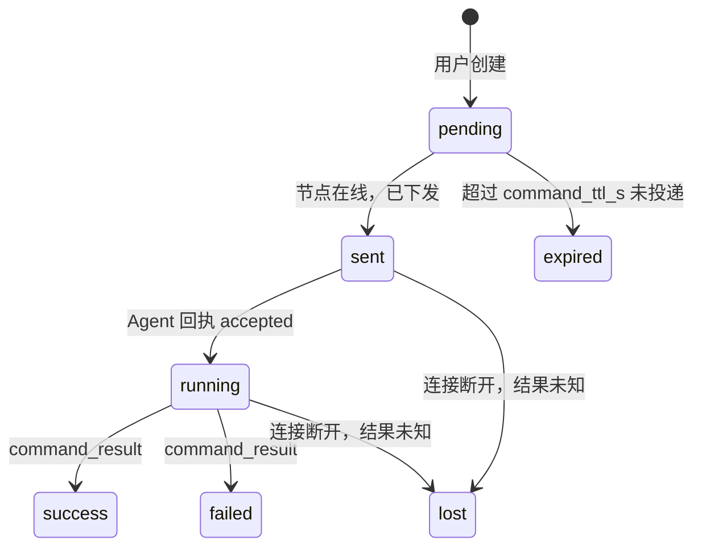
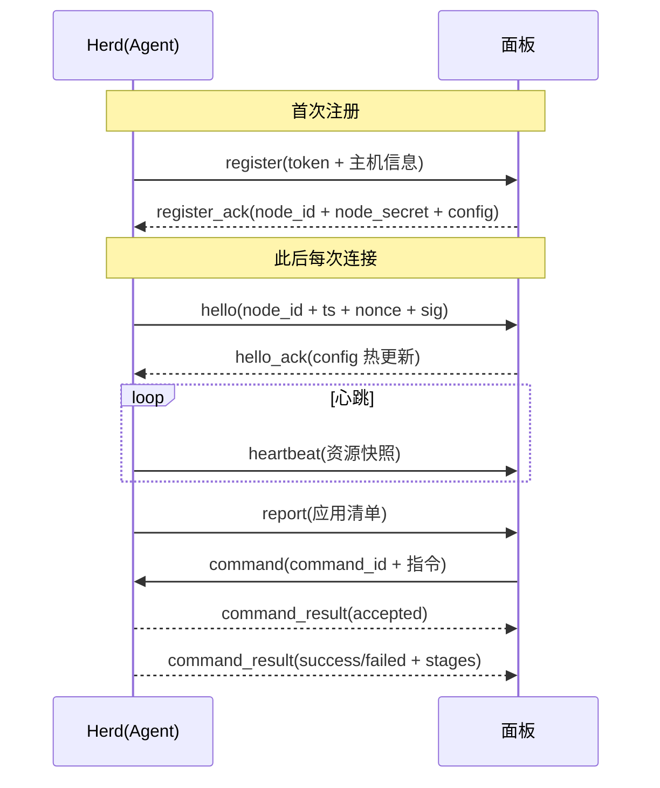

# 牧云 MoonShepherd · 通信协议规范

> 版本：v0.1（设计稿） · 日期：2026-10-25 · 当前 proto_version：**1.0**
>
> 姊妹文档：[01-产品总体设计](01-产品总体设计.md) · [03-迭代路线图](03-迭代路线图.md) · [05-安全设计](05-安全设计.md)
>
> 本文档是 `internal/protocol`（双端唯一共享代码，见 [02](02-技术选型与工程结构.md)）的实现依据；[01](01-产品总体设计.md) §5 为本规范的概念概览。

## 1. 协议总则

- **传输**：单一 WSS 连接（TLS 强制；明文 `ws://` 仅允许 `127.0.0.1` 调试场景）
- **编码**：WebSocket 文本帧，UTF-8 JSON；单帧 payload 上限 **1 MiB**，超限截断并置 `truncated: true`（日志流等大流量场景走 §6 分片）
- **方向**：Agent 主动外连，面板永不反向连接 Agent；指令复用该连接下发
- **信封**：

```json
{
  "id": "9f1c8a3e-...（UUID v4，发送方生成）",
  "type": "heartbeat",
  "ts": 1761139200,
  "payload": { }
}
```

- **兼容性**：
  - `proto_version` 采用"主.次"语义；面板向后兼容同主版本的全部次版本
  - 收到未知 `type`：回 `error(2001)`，**不断连**（前向兼容，旧面板/新 Agent 混跑）
  - 破坏性变更升主版本；面板保留上一主版本支持至少一个大版本周期

## 2. 连接生命周期与节点身份认证

### 2.1 身份模型：长期密钥 + HMAC 挑战

```
首次注册（一次性）：registration_token（一次性、24h 时效）
                        ↓ 换发
                    node_id + node_secret（明文仅此一次，TLS 保护下传输）
此后每次连接：      node_id + HMAC-SHA256(node_secret, node_id|ts|nonce)
                        —— secret 永不再明文传输
```

设计取舍：不引入 mTLS 证书体系（个人/小团队节点规模的证书运维成本过高），HMAC 挑战达到同等安全目标——凭据不明文重传、防重放、可撤销；面板侧 secret 加密落库（见 [05](05-安全设计.md) §3.4）。

### 2.2 首次注册（register / register_ack）

面板管理员先在 UI 发放一次性注册 Token（默认 24h 过期、单次使用、可随时撤销）。

Agent → `register`：

```json
{
  "registration_token": "rt_9a8b...",
  "hostname": "nas",
  "os": { "name": "Unraid", "version": "7.1", "arch": "x86_64" },
  "agent_version": "0.1.0",
  "proto_version": "1.0",
  "capabilities": ["docker", "nginx", "caddy"]
}
```

| 字段 | 必填 | 说明 |
|---|---|---|
| registration_token | ✓ | 面板发放的一次性 Token |
| hostname | ✓ | 主机名（展示名，面板侧可改） |
| os.name / os.version / os.arch | ✓ | 系统信息（arch 取值 amd64/arm64/arm） |
| agent_version | ✓ | 语义化版本 |
| proto_version | ✓ | 协议主.次版本 |
| capabilities | ✓ | 可用探测器名列表（探测能力协商） |

面板校验通过 → `register_ack`（**唯一一次明文下发 secret**）：

```json
{
  "node_id": "n_a1b2c3d4...",
  "node_secret": "sec_f6e5...(256bit 随机)",
  "config": { "heartbeat_interval_s": 30, "probe_interval_s": 300, "command_ttl_s": 600 }
}
```

面板侧动作：生成 node_id（UUID）与 node_secret（crypto/rand 256bit）；`nodes.credential_enc` 存 AES-256-GCM 加密后的 secret（见 05 §3.4）；注册 Token 立即标记 `used`。Token 无效/过期 → `error(1001/1002)` 并断连，Agent 终止重试并提示重新获取 Token。

Agent 收到后原子写入本地凭据文件（0600）：`server` / `node_id` / `node_secret` 三项。

### 2.3 后续连接认证（hello / hello_ack）

每次 WSS 建立后，Agent 的**第一条消息**必须是 `hello`：

```json
{
  "node_id": "n_a1b2c3d4...",
  "ts": 1761139200,
  "nonce": "8f3a9c...（crypto/rand 128bit hex，每连接唯一）",
  "sig": "hex(HMAC-SHA256(node_secret, node_id + \"|\" + ts + \"|\" + nonce))"
}
```

面板验证链：

1. node_id 存在且节点未禁用（否则 close 4002）；
2. `|面板当前时间 − ts| ≤ 300s`（时钟偏移容忍窗口，防重放）；
3. nonce 在该节点近期未出现过（每节点内存去重集，防窗口内重放）；
4. 解密 credential_enc 得 secret，本地重算 HMAC 比对（恒定时间比较）。

全部通过 → `hello_ack`（可捎带运行配置热更新）：

```json
{ "server_time": 1761139200, "config": { "heartbeat_interval_s": 30, "probe_interval_s": 300, "command_ttl_s": 600 } }
```

任一失败 → `error(1003/1004)` + close(4001)，Agent 按退避重连；连续认证失败超过阈值（如 10 次）则停止并提示检查凭据。

### 2.4 凭据撤销与轮换

| 场景 | 行为 |
|---|---|
| 节点删除/禁用（P0） | credential 失效；面板主动 close 既有连接（close code 4002）；Agent 收到 4002 后停止运行并提示 |
| secret 疑似泄露（P0 应急） | 走"删除节点 + 新 Token 重注册"流程 |
| 在线轮换（P1） | 面板下发 `credential.rotate`（含新 secret，TLS 内传输），Agent 原子替换本地凭据并确认 |

### 2.5 面板下发认证结果的连接关闭码（WebSocket close code）

| code | 含义 | Agent 侧动作 |
|---|---|---|
| 4001 | 认证失败 | 退避重连；连续失败超限则停止 |
| 4002 | 节点已禁用/删除 | 停止运行，提示联系管理员 |
| 4003 | 协议主版本不支持 | 提示升级 Agent |
| 4004 | 服务过载 | 退避重连 |

## 3. 心跳、断线与重连

| 项 | 规则 |
|---|---|
| 心跳间隔 | 默认 30s（`hello_ack`/`register_ack` 的 config 可调，范围 10–300s） |
| 判离线 | 3 个心跳周期无心跳 → 面板标记 `offline` 并主动关闭连接 |
| 连接保活 | TCP keepalive 开启（NAT 映射保活，防半开连接） |
| Agent 重连策略 | 指数退避：1s → 2s → 4s → … 封顶 60s，叠加 ±20% 随机抖动（防面板重启后的重连风暴） |
| 重连语义 | 重连 = 完整重新认证（§2.3），无任何"半认证恢复" |

## 4. 指令：状态机、投递与幂等

### 4.1 指令状态机（面板视角）



### 4.2 投递语义

- 指令仅经当前活跃连接下发；节点 offline 时指令停留 `pending`
- 节点重连认证完成后，面板按创建时间顺序补投未过期的 `pending` 指令
- `lost`（结果未知）**不自动重发**——`exec` / `config.apply` 有副作用，盲目重试可能重复执行；面板 UI 对 lost 指令提供"人工重发"按钮（生成新 command_id）

### 4.3 幂等（Agent 视角）

- `command_id` 由面板生成（UUID v4），全局唯一
- Agent 维护已完成 command_id 的 LRU 缓存（容量 1000 条 / 24h 滚动过期）；收到缓存内已有的 command_id → 不重复执行，直接重放上次 result（应对补投/网络重传造成的重复投递）
- 回执两段式：收到即回 `accepted`（表示已受理）；执行完毕回 `command_result`（最终结果）

## 5. 消息字段定义

### 5.1 heartbeat（A→P，周期性）

```json
{
  "cpu_percent": 12.3,
  "mem": { "used_mb": 2048, "total_mb": 8192 },
  "disk": { "path": "/", "used_gb": 120, "total_gb": 500 },
  "net": { "rx_kb_s": 12.4, "tx_kb_s": 3.1 },
  "load1": 0.52, "uptime_s": 864000
}
```

| 字段 | 说明 | 采集降级 |
|---|---|---|
| cpu_percent | 采样周期均值 | 读 /proc 不可用时省略字段 |
| mem / disk | 单值快照；disk 为根文件系统（多盘 → P1 扩展数组） | BusyBox `df` 降级 |
| net | 速率（Agent 本地做差分） | 不可得时省略 |
| load1 / uptime_s | 可选 | |

面板对缺失字段的策略：忽略并照常更新 `last_seen`；连续缺失计入节点"探测降级"提示。

### 5.2 report（A→P，定时/按需）

```json
{
  "probe_name": "docker",
  "detected_at": 1761139200,
  "apps": [
    {
      "app_type": "docker",
      "name": "blog",
      "version": "wordpress:6.4",
      "status": "running",
      "detail": { "image": "wordpress:6.4", "compose_project": "blog", "ports": ["8080:80"] }
    }
  ]
}
```

| 字段 | 说明 |
|---|---|
| probe_name | 探测器名（与 register.capabilities 对应） |
| apps[] | 该探测器本次全量结果；**覆盖式更新**该节点该探测器的 `app_inventory` 行 |
| status 枚举 | `running` / `stopped` / `installed`（装了没跑）/ `unknown` |
| detail | 探测器原始 JSON，面板原样落库、前端渲染 |

探不出：`apps: []` + 空；**不确定**：单项 `status: "unknown"`，不臆造数据（01 §3.3 原则）。

### 5.3 command（P→A）

信封 `type: "command"`，payload：

```json
{ "command_id": "c_7d6e...", "type": "exec", "timeout_s": 120, "payload": { "cmd": "uptime" } }
```

各指令类型的 payload 与约束：

| 指令 | payload 字段 | 约束（P0） |
|---|---|---|
| `exec` | `cmd`（字符串，经 `/bin/sh -c` 执行） | 超时默认 120s（上限 600s）；stdout/stderr 各截断至 1 MiB |
| `probe` | `probe_names`（数组，空 = 全部） | 无风险 |
| `config.apply` | `app_type`、`target_path`、`content`、`version_id` | app_type 必须已注册 validate/reload 命令；流程见 01 §6 |
| `docker.op`（P1） | `op`（start/stop/restart/logs）、`container_id`、`tail_lines?` | 白名单操作集 |
| `agent.update`（P1） | `version`、`download_url`、`sha256` | https 强制；sha256 校验失败拒装 |

### 5.4 command_result（A→P）

```json
{
  "command_id": "c_7d6e...",
  "status": "failed",
  "exit_code": 1,
  "stdout": "...",
  "stderr": "nginx: [emerg] unknown directive...",
  "stages": [
    { "name": "backup",  "status": "success" },
    { "name": "write",   "status": "success" },
    { "name": "validate","status": "failed", "detail": "nginx: [emerg] ..." },
    { "name": "rollback","status": "success" }
  ]
}
```

| 字段 | 说明 |
|---|---|
| status | `accepted`（首段回执）/ `success` / `failed` / `expired`（Agent 侧超期拒执行） |
| exit_code / stdout / stderr | exec 类指令结果；超限截断并 `truncated: true` |
| stages | 仅 `config.apply`：backup → write → validate → reload → rollback 各阶段逐段上报（01 §6 流程的协议映射） |

### 5.5 error（双向）

```json
{ "code": 2002, "message": "payload missing field: cmd", "ref_id": "关联消息 id（可选）" }
```

### 5.6 错误码表

| 码 | 含义 | 接收方动作 |
|---|---|---|
| 1001 | registration_token 无效/已用 | Agent 终止重试，提示重新获取 Token |
| 1002 | registration_token 过期 | 同上 |
| 1003 | hello 认证失败 | Agent 退避重连；超限停止并提示检查凭据 |
| 1004 | nonce 重放 | 同 1003 |
| 2001 | 未知消息类型 | 记录后忽略（前向兼容，不断连） |
| 2002 | payload 非法 | 记录告警；指令类回 failed |
| 2003 | 指令类型不支持（如旧 Agent 收到 docker.op） | 指令回 failed，注明不支持 |
| 3001 | 节点已禁用 | Agent 停止运行 |
| 3002 | 协议主版本不支持 | Agent 提示升级 |

## 6. 分片传输（P1 预留，log_tail 使用）

超过单帧上限的流式数据（容器日志等）采用分片：

```json
{ "ref_id": "流标识", "seq": 0, "total": -1, "data": "文本分片", "eof": false }
```

- `total = -1` 表示流式（长度未知），以 `eof: true` 收尾；接收端按 `ref_id + seq` 重组
- 面板可随时发 `stream.stop`（含 ref_id）终止推送
- 分片不重传：连接断开即流终止，客户端重新发起

## 7. 时序总览


